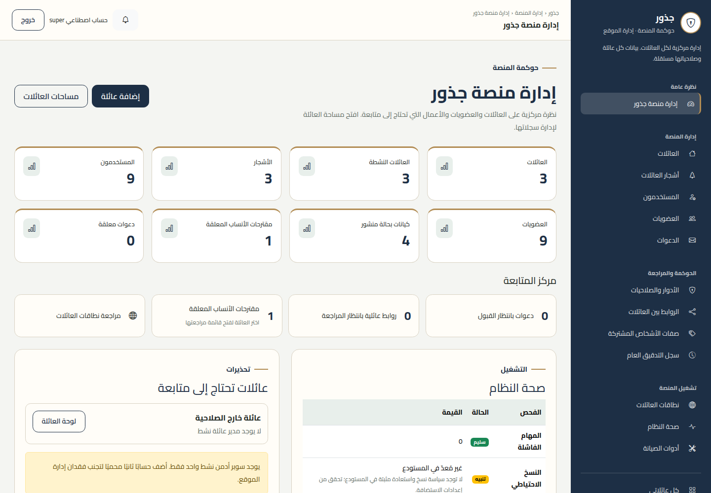
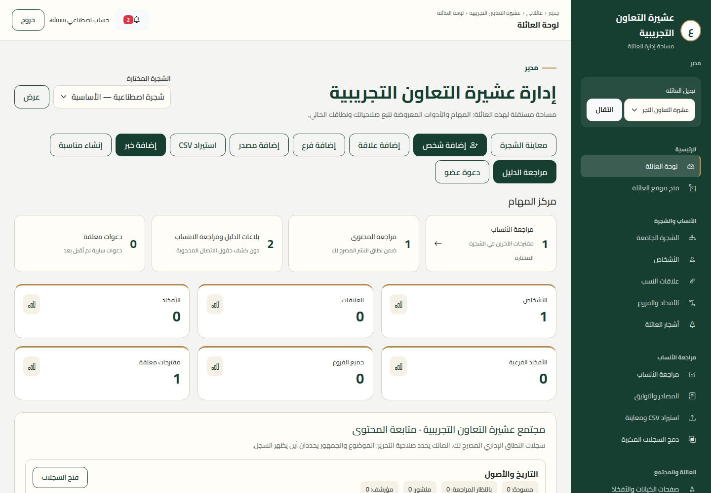

# UX-P0.9 — Platform and family administration

Implemented 2026-10-29. Starting state: `main` at `327d9c55`, clean. Laravel 13.31, PHP 8.3.6, Blade, Bootstrap/Cairo, native JavaScript. No dependency, database-schema, domain-host, authentication or permission-catalog change. No application database reset, production migration, deployment or Git commit.

## Baseline and disposition

The full baseline was reproduced before dashboard changes: **467 tests, 432 passed, 35 failed**. [Exact names, categories and causes](admin-ux-p0.9-baseline.md), [baseline JSON](admin-ux-p0.9-baseline.json). Six actual before screenshots cover platform/family, news editor, directory moderator, genealogy reviewer and mobile family administration.

Two directly relevant dashboard defects were fixed: core failed-job and backup indicators disappeared when optional diagnostics were disabled. Basic read-only operational information now remains visible; optional diagnostics stay disabled unless the super administrator enables them.

The other 33 baseline failures remain. They include inconsistent historical visibility expectations, legacy seed/audit contracts, retired static URLs, disabled optional-tool assumptions and an existing public-source-file exposure check. These are not all harmless fixture failures. In particular, living/unknown public-name assertions and files detected in `public/docs` remain release/security blockers. PersonPrivacy, public eligibility and source evidence were not silently changed to hide these failures.

An initial concurrent PostgreSQL run encountered a test media-file write failure. The isolated database was not the cause: `Storage::fake` roots were shared with the SQLite process. Subsequent PostgreSQL runs use Laravel's supported `LARAVEL_STORAGE_PATH` override with a separate temporary storage directory. A PostgreSQL demo-fixture snapshot also exposed unspecified SQL ordering. Both snapshots in that test now use `orderBy('id')`; every row, field and idempotency/isolation assertion remains intact. No seeder implementation changed.

## Administration architecture

| Layer | Entry point / responsibility |
|---|---|
| Compatibility entry | `layouts/management.blade.php` remains the parent of existing management screens; it selects platform, family or personal workspace context |
| Platform frame | `layouts/platform-admin.blade.php`: central Juthoor governance identity, platform navigation and operational context |
| Family frame | `layouts/family-admin.blade.php`: current family identity, published approved palette/logo and authorized family switching |
| Shared shell | `layouts/admin-shell.blade.php`: assets, landmarks, breadcrumbs, notifications, account controls, mobile drawer, validation/success feedback |
| Shared primitives | `components/admin/{navigation,page-header,stat-card,empty-state}` plus existing forms, tables, pagination, notices and review-diff components |
| Navigation presentation | `AdministrationWorkspace`: reads canonical FamilyPermissions, existing policies, CommunityEntityAccess and MaintenanceTools; produces navigation and presentation capabilities, not new authorization rules |
| Family data | Existing FamilyDashboardService / FamilyHealthService; genealogy counts follow selected tree, community/moderation scopes follow the family and effective entity ownership permissions |
| Platform data | Existing SiteAdmin DashboardController / SiteHealthService and existing resource, role/domain/attribute controllers |
| Styles / behavior | `admin-workspace.css` uses established Juthoor tokens and approved palettes; `admin-workspace.js` adds drawer accessibility, family switching, current-navigation state and table overflow behavior |

The old `management/partials/site-nav.blade.php` and `family-nav.blade.php` were removed after confirming that no runtime/test reference remained. Their working destinations are represented in the new permission-aware navigation. No management route was removed. Existing controllers/services continue enforcing all actions regardless of hidden or visible links.

## Platform workspace

**إدارة منصة جذور** presents eight primary, database-backed statistics and an action center before maintenance tools. Families, memberships/users, scoped genealogy oversight, invitations, cross-family governance, domains, audited activity and operational health remain accessible. Supplemental account/audit/seed figures and maintenance settings are in secondary sections rather than dominating the first screen.

There is no invented family-activation request count, platform settings module, analytics chart or unsupported reporting page. Family inactivity is not relabeled as an approval request. Existing family attention checks now filter and limit in SQL before hydration. User/family metrics use conditional aggregates. Maintenance-tool state is loaded once for the platform page; the platform shell no longer loads every family for an unused switcher. Activity and families remain paginated.

Site-admin routes retain platform identity even when a controller passes a Family model to an edit view. Opening that model does not accidentally turn platform administration into the family's workspace.

## Family identity, navigation and action center

The family frame reads published PortalSettings only. Draft names/palettes are not applied. Logos still pass the existing publicImage/media authorization rule. Colors come from the approved palette map, never arbitrary CSS or JavaScript.

The family switcher contains only authorized active memberships (all families for super administrators). Each option opens the destination dashboard without carrying the previous tree, person, filter or entity. The destination controller resolves and authorizes its own family/tree. A copied foreign tree or family URL is still rejected.

Navigation groups are built from actual capabilities: genealogy and review; community content; news/events; Sanad; members/roles; settings/history. Empty groups are absent and disabled maintenance tools are omitted. Specialized users keep any existing reader/proposal capabilities, but do not receive unrelated management actions just because they can open a dashboard.

| Role/workflow | Prioritized experience |
|---|---|
| Family administrator | Scoped overview, person/branch/content actions, reviews, directory, memberships, portal identity and audit |
| Genealogy reviewer | Other authors' pending requests, comparison/history and existing review tools; own requests never count as approval tasks |
| Genealogy editor/manager | Existing person/source/branch creation and selected-tree management, with server publication/shared-ancestor guards retained |
| News editor | News/event creation and own draft/submitted totals; no unrelated media/heritage/settings controls |
| News/death-notice publisher | Existing authorized editorial queue and publication tools; sensitive consent enforcement remains in the publishing service |
| Directory moderator | Listed-profile, pending-affiliation and open-report counts; queue access without copying private contact fields into the dashboard |
| Entity administrator/editor | Existing hierarchy inheritance, owner-scoped content and publication decisions; draft siblings outside the scope are excluded |
| Reader | Existing permitted tree/proposal, voluntary directory and notification workflows, without new editing rights |

The action center is composed of existing workflow counts and recipient-specific notifications, not a new messaging system. It does not merge private payloads across families. Mixed family news-editor + entity-admin grants are explicitly tested: entity publication authority does not become family-wide review authority.

## Management workflows

- **Genealogy:** selected-tree navigation, main/sub-fakhd counts, person management and existing source/merge/recovery tools remain. Health/duplicate/branch details are secondary, with actual founder Person references. The existing tree gains only an authorized return-to-family-administration link in nonembedded private mode. All three P0.7 display modes and the layout algorithm remain unchanged.
- **Review:** category, reason-search and own-request filters, preserved status navigation, submitter context and SQL pagination. Existing before/after comparison, source/impact context, decision history, self-review rejection and shared-ancestor governance remain the review implementation; no new status was invented.
- **Family/entity hierarchy:** public ancestor/sibling context remains available; unmanageable unpublished siblings no longer appear in the entity index. News-only users receive module links rather than generic entity-edit/create buttons that would return 403. Founders and genealogy relations are not synthesized.
- **Publishing:** shared module navigation checks the existing module policy. Content lists filter title/state and paginate 20 records. Linked records remain family scoped and subject to ownership/publication visibility, with a bounded related list. The review queue uses a paginated union of permitted modules/owners and hydrates only one page; no full-record queue load or per-record permission loop. P0.8 forms, previews, scheduling, media, consent and notices remain.
- **Directory:** existing opt-in, affiliation, report, suspension and decision-history pages inherit the family frame. No contact details or professional claims were added to dashboard metrics; field consent remains in MemberDirectory.
- **Membership/RBAC:** established role descriptions, family-scope labels, permission counts, existing assignment states and family-only effective permission explanations. Platform roles are not assignable in family forms. Assignment/self-escalation checks and installed roles are unchanged.
- **Audit/recovery:** readable context and navigation to existing filtered logs/details/recovery. Reviewer-only and membership audit visibility still uses AuditLog's existing methods. No generic rollback or change to recorded history was introduced.
- **General pages:** contextual headers, visible labels on person filters, consistent status/validation feedback, existing destructive confirmations, responsive table regions and actual empty states. The family management section controller now fetches only the selected section’s paginated lists; its legacy combined overview retains its bounded sections.

## Responsive and accessibility verification

Desktop and 390px Chrome journeys cover both workspaces and the role/assignment tables. The drawer has an explicit close button, keyboard containment, inert background/closed navigation, Escape close with focus return and reduced-motion support. A skip link and labeled breadcrumb/main landmarks remain. Current-navigation state distinguishes section anchors from the dashboard itself. Tables scroll within labeled, focusable regions; no tested page has document-level horizontal overflow. Real screen-reader and exhaustive device coverage remain manual checks.

## Performance

No persistent permission cache or new infrastructure was added. Permissions/tool states are current per request. FamilyHealth's existing constant-query test still compares small and larger trees. Dashboards do not hydrate all people, members or audit rows. Content and review listings are database paginated; platform family-attention hydration is bounded.

The local synthetic fixture records actual query/response samples in the results JSON. These are not production load tests. The family administrator still performs multiple distinct genealogy/health/content aggregates; large installations should profile those queries before introducing caching that could invalidate authorization or freshness.

## Verification and operation

No new production migration is needed. The browser fixture was initialized with `migrate` on a newly created SQLite file, never by resetting an existing application database. It rejects a different database path, a non-local/testing environment or an already populated fixture family table.

- `php artisan test --compact`: full suites on isolated SQLite and PostgreSQL 16; exact baseline/final names and counts are in [results JSON](admin-ux-p0.9-results.json).
- `tests/Feature/AdministrationWorkspaceTest.php`: 11 new behavior cases for frames/branding, roles, switching, cross-family/entity denial, own review tasks, maintenance switches, filtering/pagination and mixed grants.
- Relevant security/dashboard/RBAC/content-scope suite: 61 cases on each database.
- `node tests/js/tree-layout.test.cjs`: 40 cases; new administration/browser JavaScript syntax checks also pass.
- `tests/Browser/admin-p09.cjs`: 50 actual Chrome journeys, zero page errors; six actual before screenshots and final captures.
- PHP formatted with Pint on changed files only. No test was removed, skipped or relaxed.

Local browser reproduction: create a new `/tmp/juthoor-admin-p09.sqlite`, migrate it with explicit local/testing SQLite configuration, run `tests/Browser/fixtures/admin-p09.php`, then serve that database on localhost:8050. Run the browser script with Node 20+, external Playwright and Chrome. Synthetic `p09-*` fixture accounts use `password` only in that guarded test database. Never run this fixture against an application database. PostgreSQL runs use the dedicated test database and an independent `LARAVEL_STORAGE_PATH` to avoid shared fake-file races.

### Platform and family side by side

| Platform workspace | Family workspace |
|---|---|
|  |  |

See [all screenshots and journey results](screenshots/ux-p0.9) and [baseline screenshots](admin-ux-p0.9-baseline.md).

## Readiness and limitations

UX-P0.9 delivers the differentiated administration experience and retains existing domain behavior. Experience v3.0 public-release readiness remains conditional on resolving the 33 historical failures, especially visibility-policy reconciliation and protected source-file placement, plus the previously documented production-readiness work (backup/restore, monitoring and load verification). No deployed Hostinger session was accessed or verified. This phase does not certify the existing public privacy discrepancies as safe, activate domains, or claim that a green focused suite replaces the full baseline comparison.
